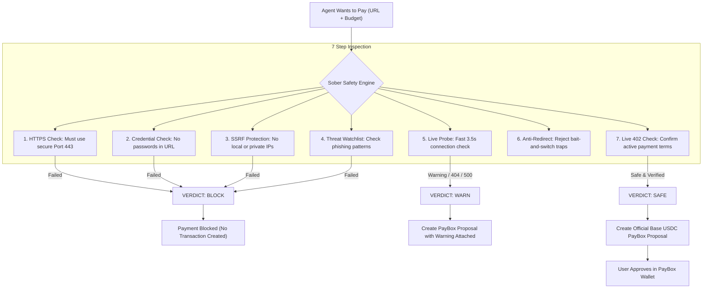

# Sober

> Clear-headed pre-payment safety and counterparty risk checks for AI agents on PayBox.

[](https://developer.paybox.sh/)
[](https://modelcontextprotocol.io/)
[-0052FF?style=flat-square&logo=coinbase)](https://base.org)
[](https://www.typescriptlang.org/)
[](https://nodejs.org/)
[](https://pnpm.io/)

---

## What is Sober?

Autonomous AI agents can now connect directly to crypto wallets and buy web services using the x402 (HTTP 402 Payment Required) standard. 

However, AI agents cannot evaluate counterparty risk on their own:
- They cannot tell if a URL is a real service or a malicious scam.
- They can easily be tricked into paying local machines, private cloud addresses, or fake websites.
- They will spend user funds even if the destination page returns a 404 error or broken code.

Sober acts as a pre-payment firewall for agent spending on PayBox. Before an agent pays for any web link, Sober scans the target URL, tests the counterparty, and determines whether it is safe.

If the link looks risky or dangerous, Sober immediately blocks it. 

If the link is verified and safe, Sober creates an official PayBox transaction proposal so you can review and approve the payment with confidence.

---

## The Problem: Why Agents Need Protection

When agents pay for APIs and services automatically, they face concrete security risks:

1. **Private Network and Server Hijacking (SSRF)**: Attackers can trick an agent into calling `127.0.0.1`, `localhost`, or internal cloud IP addresses (`169.254.169.254`), targeting private internal infrastructure.
2. **Bait and Switch (Redirect Traps)**: An endpoint takes payment for Item A, but immediately redirects the agent to an empty or malicious Item B.
3. **Ghost Payments**: The agent sends real crypto to a server that returns a 404 Not Found or a 500 Server Error, burning funds without receiving any data.
4. **Leaked Passwords**: Links with sensitive passwords or API keys typed into the URL address itself.
5. **Insecure Networks**: Unencrypted `http://` connections that allow eavesdroppers to steal or tamper with transactions.

PayBox gives agents a secure wallet and approval screen, but PayBox plugins only execute what agents propose. Sober stops bad proposals before money is ever placed at risk.

---

## How Sober Works

When an agent wants to pay for a service, Sober runs a 7-step safety pipeline:



---

## System Architecture

Here is how the user, the AI agent, Sober, and PayBox interact:

```mermaid
sequenceDiagram
    autonumber
    actor User as User
    participant Agent as AI Agent (ChatGPT or Claude)
    participant PayBox as PayBox MCP Bridge
    participant Sober as Sober Plugin (Sandbox)
    participant Service as External Paid Service
    
    User->>Agent: "Pay 0.05 USDC to get data from this service"
    Agent->>PayBox: discover_plugins()
    PayBox-->>Agent: Returns enabled plugin list with "sober"
    
    rect rgb(30, 40, 60)
    Note over Agent,Sober: Pre-Payment Safety Check
    Agent->>PayBox: use_plugin(propose_checked_payment)
    PayBox->>Sober: Starts secure sandbox check
    Sober->>Sober: Checks protocol, IP range, and credentials
    Sober->>Service: Quick 3.5s probe to check status
    Service-->>Sober: Returns HTTP 402 with price details
    Sober->>Sober: Validates terms match Base USDC
    Sober-->>PayBox: Returns verdict SAFE and transaction proposal
    end
    
    PayBox->>User: Displays approval card: "Approve 0.002 USDC on Base?"
    User->>PayBox: Confirms payment with passkey or wallet
    PayBox->>Service: Delivers payment and receives data
    Service-->>PayBox: HTTP 200 OK with requested data
    PayBox-->>Agent: Sends back clean service data
    Agent-->>User: Answers with completed results
```



---

## Available Tools

Sober gives AI agents two focused tools:

### 1. `check_service` (Safety Scanner)
Scans any web link and returns a detailed risk report without creating any payment.
- **Inputs**:
  - `url` (*required*): The web link you want to check.
  - `method` (*optional*): GET or POST (default is GET).
  - `body` (*optional*): Any JSON payload you plan to send.
- **Outputs**:
  - `verdict`: `"safe"`, `"warn"`, or `"block"`
  - `reasons`: Clear explanation of any risks found
  - `sources`: Security rules that evaluated the link
  - `hostname`: The clean domain name of the destination

### 2. `propose_checked_payment` (Safe Payment Proposal)
The main action tool. Runs the full safety check first. 
- If the URL is **BLOCKED**, it refuses to create a transaction and explains why.
- If the URL is **SAFE** or **WARN**, it generates an official PayBox Base USDC transaction proposal (`io.paybox/transactionProposal`) so you can sign it in your PayBox wallet.
- **Inputs**:
  - `url` (*required*): Target service endpoint.
  - `maxAmount` (*required*): Spending limit in atomic USDC (for example: `"50000"` equals 0.05 USDC).
  - `method` (*optional*): GET or POST.
  - `body` (*optional*): JSON payload.

---

## Live Tested Scenarios

Sober was tested against real-world situations:

| Test Case | Destination URL | What Sober Did | Final Result |
|---|---|---|---|
| Local Machine Attack (SSRF) | `http://127.0.0.1:8080/drain` | Detected plain HTTP and private loopback address | **BLOCKED**: No money spent |
| Cloud Metadata Attack | `https://169.254.169.254/latest/meta-data` | Detected internal cloud server address | **BLOCKED**: Internal theft stopped |
| Suspicious Drainer Domain | `https://my-crypto-drainer-app.com/api` | Matched known risk pattern | **BLOCKED**: Untrusted site rejected |
| Free Website (Unnecessary Cost) | `https://api.github.com` | Noticed server gives free 200 responses without 402 | **WARN**: Warns user not to waste money |
| Live Paid Service | `POST https://glim.sh/api/v1/github/get` | Probed live server and verified valid 402 terms | **SAFE**: PayBox Base USDC proposal created |

---

## Tech Stack

- **Runtime**: Node.js 24 (`v24.21.0`) and pnpm `11.11.0`
- **Language**: TypeScript 5.9 with strict type checking
- **Protocol**: Model Context Protocol (Revision `2026-07-28`)
- **Schema Validation**: JSON Schema 2020-12 via Ajv 8
- **Payment Network**: Base mainnet (`eip155:8453`) using USDC (`0x833589fCD6eDb6E08f4c7C32D4f71b54bdA02913`)
- **Bundler**: esbuild single-file ESM bundle (`dist/plugin.mjs` at ~388 KiB)

---

## Building Locally

### 1. Install Packages
```bash
pnpm install --frozen-lockfile
```

### 2. Type Check
```bash
pnpm run typecheck
```

### 3. Build the Plugin Bundle
```bash
pnpm run build
```
Builds the standalone `dist/plugin.mjs` file ready for PayBox upload.
