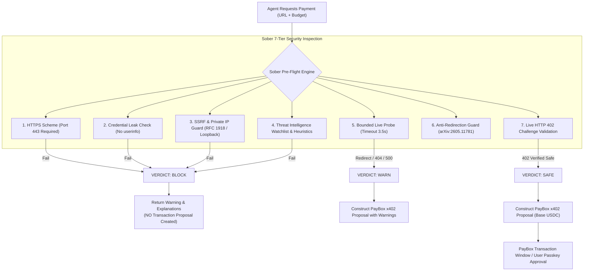

# Sober 🍸
> **Clear-headed pre-payment safety and counterparty risk verification for AI agents on PayBox.**

[](https://developer.paybox.sh/)
[](https://modelcontextprotocol.io/)
[-0052FF?style=for-the-badge&logo=coinbase)](https://base.org)
[](https://www.typescriptlang.org/)
[](https://nodejs.org/)
[](https://pnpm.io/)

---

## 📌 Executive Summary

As autonomous AI agents acquire wallet capabilities and begin purchasing web services via the **HTTP 402 Payment Required (x402)** protocol, they expose users to severe economic and infrastructural vulnerabilities. Agents cannot inherently distinguish between a legitimate payment gateway, a phishing drainer, an SSRF loopback trap, or a broken endpoint.

**Sober** acts as an intelligent pre-payment firewall for PayBox. Before an agent can propose or sign an x402 payment, Sober performs multi-layered static and active pre-flight checks. Only when an endpoint is proven secure and compliant does Sober generate an official, standard `io.paybox/transactionProposal` ready for user approval.

---

## 🚨 The Problem

Recent 2026 security research into agentic payment systems (*arXiv:2605.30998*, *arXiv:2605.11781*, *arXiv:2607.19545*) documents critical failure modes in autonomous x402 facilitators:

1. **SSRF & Internal Drainage**: Agents can be prompted or tricked into calling `127.0.0.1`, `localhost`, or cloud metadata services (`169.254.169.254`), exposing internal microservices and leaking credentials.
2. **Cross-Resource Substitution**: Malicious endpoints accept payment for Resource A while redirecting (`HTTP 301/302/307`) to Resource B or empty content.
3. **Ghost Settlements**: Agents paying endpoints that return `HTTP 404` or `500`, permanently burning tokens with zero goods returned.
4. **Credential Leakage**: Sensitive basic-auth credentials or tokens embedded directly in URLs.
5. **Protocol Downgrade**: Insecure, unencrypted `http://` transport exposing payment metadata to man-in-the-middle attacks.

PayBox provides secure execution rails, vault storage, and passkey approvals—**but PayBox plugins only execute what agents propose.** Sober fills the missing pre-payment verification layer.

---

## 💡 The Solution: How Sober Protects Agents

Sober intercepts the payment intent and performs a 7-tier verification pipeline before any transaction proposal is constructed:



---

## 🏗️ Architecture & Interaction Flow

Sober integrates directly into the PayBox Model Context Protocol (MCP) ecosystem:

```mermaid
sequenceDiagram
    autonumber
    actor User
    participant LLM as AI Agent (ChatGPT / Claude)
    participant PayBox as PayBox Host / MCP Bridge
    participant Sober as Sober Plugin (Sandbox)
    participant Endpoint as External x402 Service
    
    User->>LLM: "Pay 0.05 USDC to service for repository data"
    LLM->>PayBox: discover_plugins()
    PayBox-->>LLM: returns ["sober"]
    
    rect rgb(30, 40, 60)
    Note over LLM,Sober: Pre-Payment Safety Check
    LLM->>PayBox: use_plugin(tool: "propose_checked_payment", input: {url, maxAmount})
    PayBox->>Sober: Invokes isolated sandboxed runner
    Sober->>Sober: Static Analysis (SSRF, HTTPS, Credentials, Threat lists)
    Sober->>Endpoint: Bounded Pre-Flight Probe (3.5s)
    Endpoint-->>Sober: HTTP 402 Payment Required Challenge
    Sober->>Sober: Evaluate response & terms
    Sober-->>PayBox: Returns { verdict: "safe", io.paybox/transactionProposal }
    end
    
    PayBox->>PayBox: Validate challenge terms against Base USDC
    PayBox->>User: Prompts approval: "Approve 0.002 USDC to glim.sh on Base?"
    User->>PayBox: Signs with Passkey / Wallet
    PayBox->>Endpoint: Submits payment & retrieves data
    Endpoint-->>PayBox: 200 OK + Payload
    PayBox-->>LLM: Delivers paid response
    LLM-->>User: Answers with verified service data
```



---

## 🛠️ MCP Tools Provided

### 1. `check_service` (Read-Only Safety Inspection)
Performs non-transactional pre-flight inspection and counterparty risk evaluation on an x402 URL.
- **Input**:
  - `url` (*string, required*): The target service URL.
  - `method` (*"GET" | "POST", optional*): HTTP method (default: `"GET"`).
  - `body` (*json, optional*): Request payload.
- **Output**:
  ```json
  {
    "verdict": "safe" | "warn" | "block",
    "reasons": ["string"],
    "sources": ["string"],
    "hostname": "string"
  }
  ```

### 2. `propose_checked_payment` (Guarded Transaction Proposal)
Runs the complete safety verification pipeline. If the target is safe or warning-cleared, it generates an official PayBox Base USDC transaction proposal (`io.paybox/transactionProposal`). **If blocked, proposal generation is suppressed entirely.**
- **Input**:
  - `url` (*string, required*): The target service URL.
  - `maxAmount` (*string, required*): Atomic USDC maximum spend (e.g. `"50000"` = 0.05 USDC).
  - `method` (*"GET" | "POST", optional*): HTTP method.
  - `body` (*json, optional*): Request payload.
- **Output**:
  ```json
  {
    "verdict": "safe" | "warn" | "block",
    "reasons": ["string"],
    "sources": ["string"],
    "hostname": "string",
    "io.paybox/transactionProposal": {
      "version": "1",
      "kind": "x402",
      "chain": "eip155:8453",
      "expiresAt": "2026-10-17T18:30:00Z",
      "request": { "url": "...", "method": "POST", "body": { ... } },
      "payment": {
        "asset": "0x833589fCD6eDb6E08f4c7C32D4f71b54bdA02913",
        "maxAmount": "50000"
      }
    }
  }
  ```

---

## ⚡ Real-World Verification

Sober was verified live in both the PayBox Developer Portal and live via ChatGPT connected to PayBox:

| Scenario | Input Target | Sober Action | Result |
|---|---|---|---|
| **SSRF / Localhost Attack** | `http://127.0.0.1:8080/drain` | Insecure protocol & loopback IP detected | **BLOCKED**. Zero funds at risk. |
| **Cloud Metadata Leak** | `https://169.254.169.254/latest/meta-data` | Cloud link-local metadata address detected | **BLOCKED**. SSRF prevented. |
| **Phishing / Drainer Pattern** | `https://crypto-drainer-service.com/pay` | Host matches known malicious threat pattern | **BLOCKED**. Counterparty rejected. |
| **Live x402 Base Payment** | `POST https://glim.sh/api/v1/github/get` | Probed, confirmed live HTTP 402 challenge | **SAFE**. Proposal created & validated on Base USDC (`0x8335...`). |

---

## 💻 Tech Stack & Standards

- **Runtime**: Node.js 24 (`v24.21.0`), pnpm `11.11.0`
- **Language**: TypeScript 5.9 with strict typecheck
- **Protocol**: Model Context Protocol (Revision `2026-07-28`)
- **Schema Validation**: Self-contained JSON Schema 2020-12 via Ajv 8
- **Blockchain Rails**: Base mainnet (`eip155:8453`), USDC (`0x833589fCD6eDb6E08f4c7C32D4f71b54bdA02913`)
- **Bundler**: esbuild single-file ESM bundle (`dist/plugin.mjs` ≤ 10 MiB, deterministic build)

---

## 🚀 Development & Build

### 1. Install Dependencies
```bash
pnpm install --frozen-lockfile
```

### 2. Type Check
```bash
pnpm run typecheck
```

### 3. Build Plugin
```bash
pnpm run build
```
Produces an optimized, self-contained single-file bundle at `dist/plugin.mjs` (~388 KiB).

---

## 📄 License

MIT License. Built for the **PayBox Chapter 1 Hackathon**.
